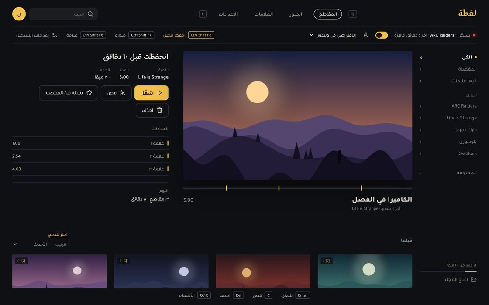
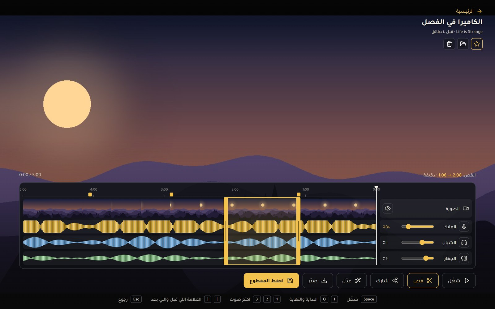
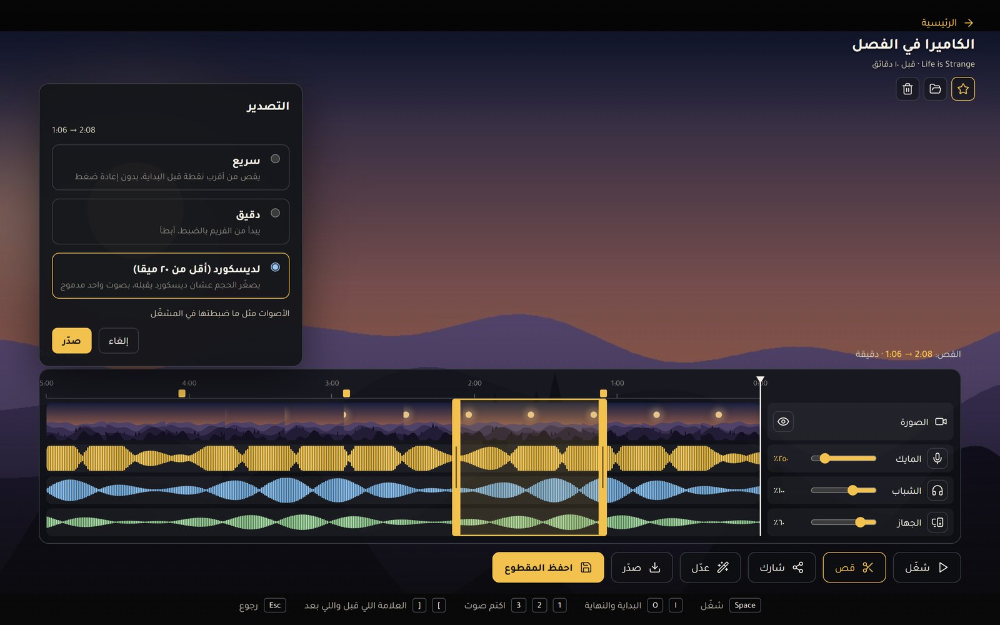
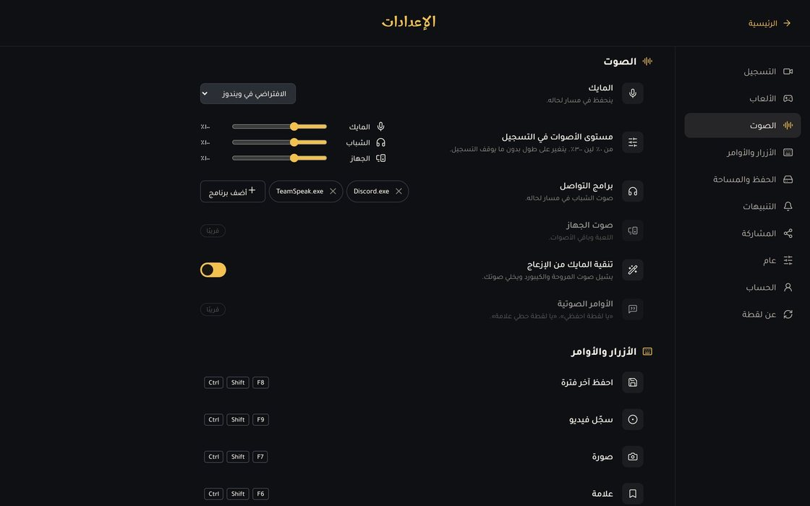

# لقطة

**مسجّل لقطات الألعاب لويندوز.** يسجّل لعبك بهدوء في الخلفية، وإذا صار شي يستاهل تضغط زر واحد ويحفظ آخر الدقائق، بصوتك وصوت أصحابك وصوت اللعبة كل واحد في مسار لحاله.

مجاني وبدون إعلانات.

### [⬇️ نزّل آخر إصدار](https://github.com/ldo2x/laqta/releases/latest) · [صفحة لقطة](https://ldo2x.github.io/laqta/)

## وش يسوي

- **آخر الدقائق بزر:** تختار المدة من دقيقة لين ساعة، وتضغط <kbd>F8</kbd>.
- **بصوتك:** قل «Laqta, clip that» وتنحفظ اللقطة، أو «Laqta, shoot that» وتنحفظ صورة. الاستماع على جهازك بس، وتقدر تطفيه.
- **تنبيه هادي فوق اللعبة:** يقول «تم حفظ آخر ٥ دقائق»، والصورة تطلع فيه، ولكل شي صوت خاص.
- **ثلاث مسارات صوت:** المايك، وبرامج التواصل مثل ديسكورد، وصوت اللعبة. كل واحد تتحكم فيه من ٠٪ لين ٣٠٠٪.
- **تنقية المايك:** يشيل صوت المروحة والكيبورد ويخلي صوتك.
- **قطّع ورتّب:** قطّع المقطع بالمقص، احذف اللي ما تبيه والفراغ يتسكّر، ورتّب القطع بالسحب. وحط علامة وقت اللعب وارجع لها.
- **ألبومات:** اسحب مقطع فوق مقطع ثاني ويصيرون في ألبوم واحد.
- **تعديل:** تسريع وتبطيء، قص طولي للجوال، كتابة على الفيديو، دمج مقاطع، أو احفظ الصوت بس.
- **مشاركة:** تصدير لديسكورد تحت حد الرفع، أو نسخ الملف ولصقه في أي محادثة، أو إرسال لقناة ديسكورد.
- **إعدادات لكل لعبة:** طول اللقطة والجودة.
- **خفيف:** يسجّل بكرت الشاشة (إنفيديا، إي إم دي، إنتل)، وآخر الدقائق تنحفظ على الهارديسك مو في الذاكرة.
- **التحديثات توصلك لحالها**، وما تقطع عليك تسجيل.

## التثبيت

1. نزّل `Laqta_..._x64-setup.exe` من [آخر إصدار](https://github.com/ldo2x/laqta/releases/latest).
2. شغّله. لو طلعت لك شاشة ويندوز الزرقاء (SmartScreen)، اضغط «معلومات إضافية» وبعدها «تشغيل على أي حال». تطلع لأن البرنامج جديد وما عليه توقيع مدفوع للحين.
3. سجّل دخول بجوجل أو باسم مستخدم. التسجيل نفسه يشتغل حتى لو انقطع النت.

**تحتاج:** ويندوز ١٠ أو ١١ (٦٤ بت)، وكرت شاشة فيه مسجّل فيديو. أغلب الكروت من آخر عشر سنين فيها.

## الأزرار

| الزر | وش يسوي |
|---|---|
| <kbd>F8</kbd> | احفظ آخر الدقائق |
| <kbd>F9</kbd> | ابدأ أو وقّف تسجيل فيديو |
| <kbd>F7</kbd> | صورة للشاشة |
| <kbd>F6</kbd> | علامة |
| «Laqta, clip that» | احفظ آخر الدقائق بصوتك |
| «Laqta, shoot that» | صورة للشاشة بصوتك |

تقدر تغيّرها من الإعدادات.

## الخصوصية

مقاطعك تبقى في جهازك، وما ترتفع لأي مكان إلا إذا أرسلتها أنت. التفاصيل في [صفحة الخصوصية](https://ldo2x.github.io/laqta/privacy.html).

## مشكلة أو اقتراح؟

افتح [بلاغ جديد](https://github.com/ldo2x/laqta/issues/new/choose). وإذا تقدر، أرفق مجلد السجلات: تلقاه في الإعدادات ← «عن لقطة» ← «سجلات المحرك».

---

## Laqta (English)

A game clip recorder for Windows. It records quietly in the background; press one key and it saves the last minutes, with your mic, voice chat and game sound on separate tracks. Free, no ads.

- [Download the latest release](https://github.com/ldo2x/laqta/releases/latest) · [Website](https://ldo2x.github.io/laqta/)
- Windows 10 or 11 (64-bit) and a graphics card with a video encoder (NVIDIA, AMD or Intel).
- SmartScreen may warn on first run because the app isn't code-signed yet: choose **More info → Run anyway**.
- Features: say “Laqta, clip that” or “Laqta, shoot that” (offline), a replay buffer from 1 minute to 1 hour, three audio tracks at 0–300% each, a mic noise filter, markers, albums by drag and drop, a lane timeline editor (a cutter to split, delete and reorder pieces, speed, vertical crop, text, merge, sound only), Discord-sized export, per-game settings, and automatic updates.
- Problems or ideas: [open an issue](https://github.com/ldo2x/laqta/issues/new/choose).

Built with [FFmpeg](https://ffmpeg.org) (LGPL), [RNNoise](https://github.com/xiph/rnnoise) via nnnoiseless, and [sherpa-onnx](https://github.com/k2-fsa/sherpa-onnx) with its GigaSpeech keyword model (Apache-2.0) and ONNX Runtime (MIT) for the voice commands.
